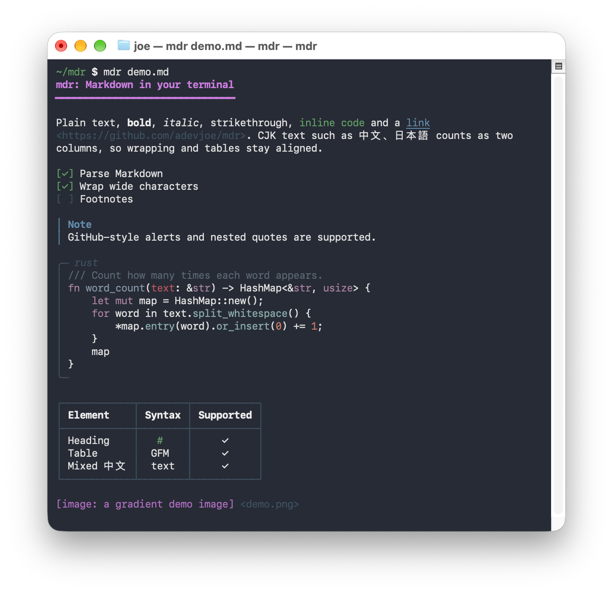
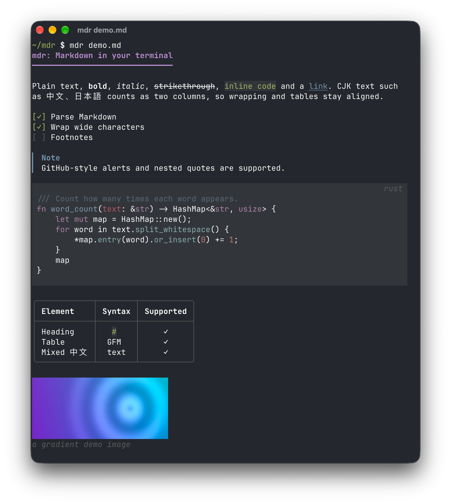

# mdr

**English** | [简体中文](README.zh-CN.md)

A command-line tool that renders Markdown in the terminal, written in Rust. It is CJK-friendly:
full-width characters count as two columns, so wrapped text and tables never fall out of alignment.

```
mdr README.md
cat notes.md | mdr
```

## Screenshots

In macOS Terminal (basic style):



The same document in Ghostty, where mdr switches to the rich style: code panels, inline code backgrounds,
dotted link underlines, rounded tables and inline images:



The document is [`docs/images/demo.md`](docs/images/demo.md); for every supported element, see
[`examples/sample.md`](examples/sample.md).

## Installation

### macOS: Homebrew (recommended)

```sh
brew install adevjoe/tap/mdr
```

Upgrade with `brew upgrade mdr`, uninstall with `brew uninstall mdr`.
Homebrew on Linux works the same way, if you already use it there.

### Linux: install script (recommended)

```sh
curl -fsSL https://raw.githubusercontent.com/adevjoe/mdr/main/install.sh | sh
```

The script downloads the prebuilt binary for your OS and CPU, verifies its SHA-256 and installs it to
`~/.local/bin` (`/usr/local/bin` for root). The Linux build is statically linked and supports x86_64 and
aarch64 on any distribution. If you have `wget` but no `curl`, replace `curl -fsSL` with `wget -qO-`.

```sh
# Pick a version or install directory
curl -fsSL https://raw.githubusercontent.com/adevjoe/mdr/main/install.sh | sh -s -- --version v0.2.0 --dir /usr/local/bin
```

To upgrade, run it again; to uninstall, delete `mdr` from the install directory.
The script also works on macOS if you'd rather not use Homebrew.
You can also download binaries manually from the [Releases](https://github.com/adevjoe/mdr/releases) page.

### From source

Requires a Rust toolchain (1.88 or newer).

```sh
git clone https://github.com/adevjoe/mdr.git
cd mdr
cargo install --path .
```

`cargo install` puts `mdr` in `~/.cargo/bin`; make sure that directory is on your `PATH`.

If you'd rather not install it, just build and run:

```sh
cargo build --release
./target/release/mdr examples/sample.md
```

Uninstall with `cargo uninstall mdr`.

## Usage

```sh
mdr file.md              # render a file
cat file.md | mdr        # read from standard input
mdr - < file.md          # same; "-" means standard input
mdr --width 60 file.md   # set the layout width
mdr --no-color file.md   # no colors
mdr --no-pager file.md   # print directly even when the output is long
```

To see every element in action, run:

```sh
mdr examples/sample.md          # English sample
mdr examples/sample.zh-CN.md    # Chinese sample
```

### Options

| Option | Description |
|--------|-------------|
| `FILE` | File to render. Reads standard input when omitted or `-` |
| `-w, --width <N>` | Layout width (at least 10 columns). Defaults to the terminal width, then `$COLUMNS`, then 80 |
| `--no-color` | No colors or styles; same as `--color never` |
| `--color <auto\|always\|never>` | When to use colors. Default `auto` |
| `--hyperlinks <auto\|always\|never>` | When to make links clickable terminal hyperlinks. Default `auto` |
| `--style <auto\|rich\|basic>` | Display style. `auto` uses the rich style in Ghostty, kitty and WezTerm, basic elsewhere |
| `--images <auto\|always\|never>` | When to display local images in the terminal. Default `auto` (Ghostty, kitty) |
| `--no-pager` | Don't use a pager |
| `-h, --help` / `-V, --version` | Help / version |

### Colors

By default (`--color auto`) colors are only used when writing to a terminal. Output is plain text when:

- output is piped or redirected, e.g. `mdr a.md > a.txt` or `mdr a.md | grep Title`;
- the `NO_COLOR` environment variable is set to a non-empty value (see [no-color.org](https://no-color.org/));
- `--no-color` or `--color never` is given.

Command-line options take precedence over the environment: `--color always` emits colors even with
`NO_COLOR` set or when piped, which suits usage like `mdr --color always a.md | less -R`.

Without colors, inline code is wrapped in backticks `` ` `` so it stands apart from the surrounding text.

### Links

In terminals that support [OSC 8 hyperlinks](https://gist.github.com/egmontkob/eb114294efbcd5adb1944c9f3cb5feda)
(Ghostty, iTerm2, WezTerm, kitty, the VS Code terminal, Windows Terminal, ...), link text is clickable;
elsewhere the address is shown after the link text as `<url>`. Support is detected from environment variables;
if detection gets it wrong, use `--hyperlinks always` or `--hyperlinks never`.

Images are shown as `[image: alt text]` followed by the image address (or as a clickable link).
In Ghostty and kitty, a local image in a paragraph of its own is displayed inline; see the next section.

### Ghostty and other modern terminals

In Ghostty (as well as kitty and WezTerm), mdr automatically switches to the rich style (`--style rich`):

- **Code blocks** are drawn as solid background panels with the language name on the right; **inline code**
  gets the same background. The background is the terminal's background color slightly lightened (dark
  themes) or darkened (light themes), so it follows your color scheme; syntax highlighting also picks a
  dark or light theme to match. The background color is queried with OSC 11.
- **Links** use a dotted underline, distinct from a regular underline.
- **Block quotes and alerts** use a heavier `▎` bar (Ghostty draws block characters itself, leaving no gaps
  between lines), and **tables** have rounded corners.
- **Images**: a local image in a paragraph of its own (``) is displayed with the
  kitty graphics protocol, with its alt text underneath. PNG, JPEG, GIF and WebP are supported; relative paths
  are resolved against the Markdown file's directory; images are no wider than the layout width and no taller
  than two thirds of the window. Remote images are not downloaded, and images mixed with text (such as badges)
  are still shown as text.
- Output uses synchronized output (DEC 2026), so large documents are drawn at once without flicker.

Notes:

- The `less` pager can't show images. When the output is longer than one screen and goes to the pager,
  images fall back to text; add `--no-pager` to see them.
- Inside tmux / screen the rich style and images are off (they intercept these escape sequences);
  force them with `--style rich` if needed.
- Over ssh, Ghostty is still recognized as long as `TERM` is `xterm-ghostty`.
- Prefer the plain look? Use `--style basic`; to turn off only images, use `--images never`.

### Pager

When writing to a terminal and the output is longer than one screen, mdr pipes it to `less -R`; press `q` to quit.

- Disable it with `--no-pager`;
- choose another pager with the `MDR_PAGER` environment variable, e.g. `MDR_PAGER="less -RS"`;
- if the pager fails to start, output goes straight to the terminal.

## Supported elements

- Headings (six levels, each styled differently; levels 1–2 are underlined, level 3 and below show a `###` prefix)
- Bold, italic, strikethrough, inline code, and any nesting of them
- Code blocks: syntax highlighting by language (via syntect: Rust, Python, JavaScript/TypeScript, Go, Shell,
  JSON, YAML and other common languages); overlong lines are wrapped
- Ordered, unordered and nested lists; task lists (`- [x]` / `- [ ]`)
- Block quotes (nestable) and GitHub-style alerts (`> [!NOTE]`, `> [!WARNING]`, ...)
- Tables: aligned by display width, with left / center / right alignment; cells wrap when the table is too wide
- Horizontal rules, links, images, HTML blocks (shown as is)

### Wrapping rules

- Text wraps to the terminal width; CJK and other full-width characters count as two columns;
- English words are never split (unless a single word is longer than the whole line);
- Basic CJK line-breaking rules (kinsoku): punctuation like `，。！？）」` never starts a line, and `（「《` never ends one;
- Line breaks between CJK characters in the source don't turn into stray spaces.

## Development

```sh
cargo build            # build
cargo test             # unit + snapshot tests
cargo clippy           # lints
```

Parsing, layout and terminal output are independent of each other. Layout produces "lines of styled text"
without escape sequences, which keeps it easy to test.

| File | Purpose |
|------|---------|
| `src/parse.rs` | Parses Markdown into a block tree with pulldown-cmark |
| `src/wrap.rs` | Wraps by display width (wide characters, kinsoku, soft breaks) |
| `src/render.rs` | Layout: headings, list indentation, quotes, code blocks, table column widths, ... |
| `src/highlight.rs` | Syntax highlighting for code blocks |
| `src/theme.rs` | Colors and styles per element (basic and rich looks) |
| `src/term.rs` | Detects Ghostty and other terminals, queries background color and cell pixel size |
| `src/graphics.rs` | Loads and scales images, emits kitty graphics protocol sequences |
| `src/output.rs` | Emits ANSI styles, OSC 8 hyperlinks and image escapes |
| `src/main.rs` | CLI options, color and terminal capability detection, terminal width, pager |

Snapshot tests live in `tests/snapshots.rs`, with snapshots in `tests/snapshots/`. After changing the layout,
update the snapshots with:

```sh
INSTA_UPDATE=always cargo test    # or install cargo-insta and run cargo insta review
```

then check the changes with `git diff tests/snapshots`.

### CI and releases

- On every push to `main` and every PR, GitHub Actions runs format checks, shellcheck, clippy, tests and a
  release build on Linux and macOS (`.github/workflows/ci.yml`).
- To release a new version, bump `version` in `Cargo.toml`, commit, then tag and push:

  ```sh
  git tag v0.2.0 && git push origin main v0.2.0
  ```

  `.github/workflows/release.yml` runs the tests, builds binaries for macOS (arm64 / x86_64) and Linux
  (x86_64 / aarch64, statically linked with musl), and publishes a GitHub Release.
- The Homebrew formula lives in [adevjoe/homebrew-tap](https://github.com/adevjoe/homebrew-tap) and is generated
  from a release by `scripts/homebrew-formula.sh`. If the `HOMEBREW_TAP_TOKEN` Actions secret (a token with write
  access to the tap) is set in this repository, the formula is updated automatically on release; otherwise run:

  ```sh
  scripts/homebrew-formula.sh v0.2.0 > "$(brew --repository adevjoe/tap)/Formula/mdr.rb"
  ```

## Not yet supported

- Dedicated layout for footnotes, definition lists and math (currently shown as plain text or inline code)
- Custom color themes; in the basic style code highlighting always uses `base16-ocean.dark`, so a few colors
  may look faint on light terminal backgrounds (the rich style picks a theme based on the terminal background)
- Remote images, SVG, and inline images in terminals without the kitty graphics protocol (such as iTerm2)

## License

[MIT](LICENSE)
